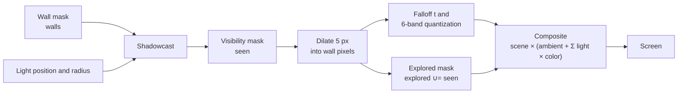

# Torchlit Abyss — 2D Shadowcasting (Torchlight and Fog of War)

[日本語](README.md) | **English**

A browser demo that implements the technique from SpriteCook's article [2D Shadowcasting for Torchlight and Fog of War](https://www.spritecook.ai/blog/2d-shadowcasting-torchlight-fog-of-war) in **plain JavaScript** (no dependencies).

**▶ Demo: https://kumi0708.github.io/torchlit-abyss/**

It uses **recursive shadowcasting** to find which grid cells are visible from a light source, and builds three things from that single result:

- **Torchlight** that is blocked by walls
- **Fog of war** that remembers places you have already seen
- **Line of sight** checks that tell whether an enemy has spotted the player

---

## Contents

1. [Controls](#controls)
2. [Pipeline overview](#pipeline-overview)
3. [The idea behind shadowcasting](#the-idea-behind-shadowcasting)
4. [Algorithm details](#algorithm-details)
5. [Per-pixel vs. per-tile](#per-pixel-vs-per-tile)
6. [Radial and cone lights](#radial-and-cone-lights)
7. [Lighting wall tops (dilation)](#lighting-wall-tops-dilation)
8. [Falloff and quantization](#falloff-and-quantization)
9. [Compositing the lighting](#compositing-the-lighting)
10. [Fog of war](#fog-of-war)
11. [Enemy line of sight and asymmetry](#enemy-line-of-sight-and-asymmetry)
12. [When to recast, and performance](#when-to-recast-and-performance)
13. [Additions beyond the article](#additions-beyond-the-article)
14. [How the graphics are made](#how-the-graphics-are-made)
15. [Pitfalls](#pitfalls)
16. [Tests](#tests)
17. [Project layout and running it](#project-layout-and-running-it)
18. [References](#references)

---

## Controls

The demo's control panel is in Japanese; the Japanese label is given in parentheses.

| Control | What it does |
| --- | --- |
| `WASD` / arrow keys | Move the player (who carries the torch) |
| Click | Place a blue lamp. Click a placed lamp again to remove it (up to 8) |
| Light radius (光の半径) | How far the torch reaches (24–160 px) |
| Torch shape (松明の形) | Switch between radial (all directions) and cone (flashlight) |
| Cone angle (扇の角度) | Opening angle of the cone (30–150°) |
| No shadows (影なし) | Turn every light into a plain radial light that ignores walls (for comparison) |
| Quantize to 6 bands (6段階に量子化) | Smooth falloff, or flat 6-step bands |
| Light wall tops (壁の上面を照らす) | Toggle the 5 px dilation |
| Fog of war (フォグ・オブ・ウォー) | When off, explored areas are not remembered and everything outside the view is black |
| Torch flicker (松明の揺らぎ) | Toggle the brightness flicker |
| Cast per tile (タイル単位でキャスト) | For comparison: cast on the tile grid and scale the result up to pixels |
| Show enemy sight (敵の視界を表示) | Highlight the three enemies' fields of view in red |

When an enemy sees the player it turns red, and the stats panel shows how many enemies have spotted you (発見された).

---

## Pipeline overview



The key point is that **visibility is kept as data**. Unlike approaches that only draw shadows in a shader, the same `seen` array drives the lighting, the fog and the game logic (enemy line of sight).

---

## The idea behind shadowcasting

The algorithm scans outward from the light one row at a time. **When it hits a wall, it stops examining the "shadow wedge" behind that wall in all later rows.**

```
. . ░ ░ ░ ░ ░ . .      @ = light
. . . ░ ░ ░ . . .      # = wall
. . . . ░ . . . .      ░ = in the wall's shadow, not visible
. . . . # . . . .      the shadow widens with distance
. . . . @ . . . .
```

- The region still being scanned is an interval of **slopes**; walls split that interval.
- Each cell is visited once, so the cost is roughly **proportional to the radius squared** (the lit area).
- Unlike casting rays one by one, it leaves no gaps and never checks the same cell twice.

This is **recursive shadowcasting**, introduced by Björn Bergström on RogueBasin. This implementation replaces recursion with an explicit stack, so deep recursion can never overflow the call stack.

---

## Algorithm details

Implementation: `shadowcast()` in [src/shadowcast.js](src/shadowcast.js)

### 1. Eight octants

The full 360° is split into eight 45° octants, and **one octant's scanning logic is reused eight times through a coordinate transform**.

```
       \  0 | 3  /
     1  \   |   /  2
  -------- @ --------        (screen coordinates: y points down)
     6  /   |   \  5
       /  7 | 4  \
```

Local coordinates `(dx, dy)` inside an octant map to grid coordinates like this:

```
x = cx + dx * xx + dy * xy
y = cy + dx * yx + dy * yy
```

| # | (xx, xy, yx, yy) | Direction |
| --- | --- | --- |
| 0 | ( 1,  0,  0,  1) | north-northwest |
| 1 | ( 0,  1,  1,  0) | west-northwest |
| 2 | ( 0, -1,  1,  0) | east-northeast |
| 3 | (-1,  0,  0,  1) | north-northeast |
| 4 | (-1,  0,  0, -1) | south-southeast |
| 5 | ( 0, -1, -1,  0) | east-southeast |
| 6 | ( 0,  1, -1,  0) | west-southwest |
| 7 | ( 1,  0,  0, -1) | south-southwest |

In local coordinates, row `j` has `dy = -j`, and `dx` is scanned from `-j` (the 45° diagonal side) to `0` (the axis side).

### 2. Slopes

The angular range a cell `(dx, dy)` covers, as seen from the light, is described by the slopes through two of its corners.

```
left  = (dx - 0.5) / (dy + 0.5)   … the cell's diagonal-side edge (larger value)
right = (dx + 0.5) / (dy - 0.5)   … the cell's axis-side edge (smaller value)
```

The range that is still visible during the scan is the interval from `start` (diagonal side, initially 1.0) to `end` (axis side, initially 0.0).

- `start < right` → the whole cell lies beyond the diagonal side of the range, so **skip it**
- `end > left` → the cell has passed the axis side of the range, so **this row is done**

### 3. Scanning a row and handling walls

```js
for (let dx = -j; dx <= 0; dx++) {
  // ...slope checks...
  if (inBounds && dx*dx + dy*dy < r*r) seen[y*w + x] = 1;   // record a visible cell
  const wall = !inBounds || walls[y*w + x];

  if (blocked) {                       // inside a run of wall cells
    if (wall) { newStart = right; continue; }
    blocked = false;                   // the wall ended; cells are visible again
    start = newStart;                  // narrow the range to the edge of the wall's shadow
  } else if (wall && j < radius) {     // a run of wall cells begins
    blocked = true;
    stack.push([j + 1, start, left]);  // scan the part before the wall separately from the next row
    newStart = right;
  }
}
if (blocked) break;                    // the wall reached the end of the row → everything beyond is shadow
```

Each time the scan enters a wall, it pushes the interval in front of the wall (the diagonal side) onto the stack. When it leaves the wall, it narrows the interval to the shadow's edge and keeps going. This is the part that is normally written as a recursive call.

### 4. Fine print

- **Walls themselves are visible** (they get lit). Only what is behind them is hidden.
- **Cells outside the grid count as walls**, so the scan never reads out of bounds.
- **The radius test is a strict `<`.** With radius 10, the cell exactly 10 away straight ahead is excluded; the light reaches 9 cells.
- The light's own cell is always visible.

---

## Per-pixel vs. per-tile

You can cast on any grid resolution. This demo treats **the whole 512×288 px map as 1 pixel = 1 cell**.

| | Per tile (32×18) | Per pixel (512×288) |
| --- | --- | --- |
| Cost | Tiny | About 0.1 ms even at radius 92 |
| Look | Blocky light that spills over the drawn walls | Smooth shadows that follow the wall outlines |
| Best for | Enemy AI checks, grid-based roguelike display | Visual lighting |

Turn on "Cast per tile" in the panel to see the per-tile result scaled up to pixels. The article also recommends **casting per pixel against the wall layer** for visual lighting. The difference is especially large with dual-grid tilesets, whose art is offset half a tile from the logic grid.

---

## Radial and cone lights

### Shadowless radial (for comparison)

With "No shadows" on, there is no shadowcast at all: the light is a plain radial light that **lights every pixel inside the radius**. Falloff, quantization and compositing stay exactly the same.

The light goes straight through walls in a circle, and you can see into the rooms behind them. Toggling it on and off shows what shadowcasting actually does. The setting also applies to placed lamps and wall torches.

### Cone (flashlight)

A cone is made by **narrowing the shadowcast result by angle**, another payoff of keeping visibility as data.

```
1. Shadowcast as usual (all directions)
2. Remove pixels more than 12 px from the center whose angle from the facing direction exceeds half the cone angle
3. Apply the wall-top lighting (5 px dilation) to what is left
4. Multiply the falloff t by a factor that fades to 0 toward the cone's edge (a smooth ~10° fade)
```

- **The inner 12 px are lit in all directions**, so you can always see your own feet and immediate surroundings, even facing away
- **Dilation runs after the cone mask**, so walls outside the cone never get lit
- The direction turns smoothly every frame toward the input direction (8 directions). It is part of the cache key in 1° steps, so the light is recast only when it changes
- The player's view becomes a cone too, so the fog of war only clears in the direction you are shining

---

## Lighting wall tops (dilation)

Implementation: `lightWallDepth()`

Shadowcasting only sees the first wall cell it hits. Per pixel, that means **only a 1-pixel rim of each wall top is lit and the rest stays pitch black**.

So the visible area is **dilated by Manhattan distance 5**, and **only the wall pixels** of that dilation are marked visible.

```
seen |= walls & dilate(seen, 5)
```

`dilate` grows the mask 5 times with a cross-shaped (up/down/left/right) structuring element, giving the same result as scipy's `binary_dilation(seen, iterations=5)`. Floor pixels are never added, so floors in shadow stay hidden. The 5 px depth suits 16 px tiles; adjust it for your tile size.

Dilation can only reach 5 pixels beyond the visible area, so the implementation processes only the visible area's bounding box, grown by 5 (see [performance](#when-to-recast-and-performance)).

---

## Falloff and quantization

For distance `d` from the light and radius `R`:

```
t     = clamp(1 - d / R, 0, 1) ^ 0.8
light = ceil(t * 6) / 6        (only for visible pixels; 0 elsewhere)
```

- The `0.8` exponent keeps the light a little brighter further out than a linear falloff would.
- `ceil(t × 6) / 6` produces **6 flat bands**, a stepped look that suits pixel art. Because it uses `ceil`, any pixel the light reaches gets at least 1/6 brightness.

| Range of t | light |
| --- | --- |
| 0 | 0 (not reached) |
| 0 < t ≤ 1/6 | 1/6 |
| 1/6 < t ≤ 2/6 | 2/6 |
| … | … |
| 5/6 < t ≤ 1 | 1 |

---

## Compositing the lighting

The final color of a visible pixel is:

```
lit = scene × (ambient + Σ light_k × color_k × flicker_k)
```

| Constant | Value | Meaning |
| --- | --- | --- |
| `ambient` | (0.045, 0.05, 0.09) | Ambient light. Shadows stay faintly blue |
| Torch color | (1.0, 0.80, 0.55) × 1.15 | Warm orange |
| Wall torch color | (1.0, 0.68, 0.40) × 0.8 | Torches mounted on walls; a little dimmer and redder than the player's |
| Lamp color | (0.45, 0.75, 1.1) | The blue light you can place by clicking (added in this demo) |

Each light adds into an accumulation buffer (three RGB planes) only over the rectangle it can reach, and all pixels are composited once at the end.

**Things that glow on their own**, such as flames, the magic crystal and the enemies' "!", are drawn after lighting at their original brightness. Otherwise a light source would be drawn dark in its own shadow.

The article's Python/numpy version does this with array math; in Godot or Unity you would write the light to a texture and multiply it in a shader. This demo computes a Canvas `ImageData` pixel by pixel and scales it up with CSS `image-rendering: pixelated`.

---

## Fog of war

Every pixel is in one of three states:

| State | Condition | Shown as |
| --- | --- | --- |
| Visible | `seen` | Lit with the formula above |
| Explored | `explored && !seen` | The background's brightness `(R+G+B)/3` × (0.30, 0.32, 0.40): **blue-gray monochrome** |
| Unexplored | neither | Black |

- `explored` is updated on every cast with `explored |= seen` and never clears unless you reset it. In a game you would save it with the level.
- Explored areas are drawn from the **background only**, before sprites are added. Otherwise enemies outside your view would show up in the fog.

---

## Enemy line of sight and asymmetry

Line of sight is just the same function cast from the enemy's position with the enemy's sight radius (72 px):

```js
shadowcast(walls, W, H, enemyX, enemyY, 72, sight);
const spotted = sight[playerY * W + playerX] === 1;
```

Note that this algorithm is **not symmetric**: A seeing B does not guarantee B sees A. In the article's tests, about 16% of tile pairs on its map were one-way. If fairness matters in your game, use a symmetric variant such as **Albert Ford's Symmetric Shadowcasting**.

---

## When to recast, and performance

### Recast only when the light moves to a new cell

`updateLight()` caches each light by a key made of its position (whole pixels), radius and options, and only recasts when the key changes. Each frame only compositing and flicker are computed.

### Measurements

Average per call on a 512×288 grid, Node.js v24, on this development machine (`shadowcast` alone).

| Operation | Time |
| --- | --- |
| Cast, radius 32 | 0.033 ms |
| Cast, radius 64 | 0.080 ms |
| Cast, radius 92 | 0.117 ms |
| Cast, radius 128 | 0.157 ms |
| Per-tile cast (32×18, radius 6) | 0.005 ms |
| Radius 92 cast + 5 px dilation (whole grid) | 2.7 ms |
| Radius 92 cast + 5 px dilation (bounding box only, current) | 0.66 ms |

The cast itself is very fast; recomputing three enemies every frame is no problem.

The dilation originally swept the whole 512×288 grid five times and took over 20× as long as the cast. Since dilation can only reach 5 pixels beyond the visible area, it is now limited to **the visible area's bounding box, grown by 5**, which made it about 4× faster. The result is identical to the whole-grid version (tested on 200 random cases).

---

## Additions beyond the article

This demo also implements things the article does not cover:

- **Torch flicker**: three sine waves with different periods are summed into a brightness factor. The radius does not change, so the bands do not shimmer.
  ```
  f = 1 + 0.06·sin(11t + φ) + 0.04·sin(23.3t + 2φ) + 0.03·sin(37.1t)
  ```
- **Multiple lights**: each light is cast separately and `light × color` is **added up**. Only what is inside the player's view is shown (you cannot see a lamp's light in places you cannot see).
- **Enemy sight overlay**: the union of the three enemies' views is tinted red.
- **Wall torches**: placed on wall faces automatically when the map is generated, each one a static light. Because they never move, they are cast only once at startup.

---

## How the graphics are made

There is not a single image file. [src/art.js](src/art.js) writes the background and every character straight into an RGBA pixel array. The random seed is fixed, so the art is the same every time.

### Floor

1. Each 16×16 tile is split into one stone, two stacked stones, or four stones
2. Each stone gets a slightly different brightness and warmth, plus fine per-pixel noise
3. The top and left edges are brightened and the bottom and right edges darkened, giving each stone a **beveled** look
4. Dark mortar lines run between stones, and some stones get **cracks** drawn with a random walk
5. **Moss** grows in the mortar, more of it near walls

### Walls

- **Top surface**: each 8 px block gets its own tone, with slightly darker seams. Edges that border the floor get a dark outline outside and a highlight inside
- **Front face** (when the tile below is floor): staggered 8×3 bricks
  - Each brick's color comes from a hash of its coordinates
  - Each brick has a highlight on top, and the face darkens toward the bottom
  - The line where the wall meets the floor is darkest
- **Wall decorations**: wall torches (bracket and flame), red banners, dripping moss

### Floor decorations and contact shadows

- A rug (gold border, diamond pattern, fringe), bones, skulls, pebbles along walls, puddles and cobwebs in room corners
- **Contact shadows**: floor at the base of walls is darkened, up to 4 px below a wall and 2 px beside one (ambient occlusion). This makes the walls look like they rise out of the floor

### Characters

Sprites are written as strings with 1 character = 1 pixel and converted to colors through a palette.

| Sprite | Size | Animation |
| --- | --- | --- |
| Hero (hooded adventurer) | 8×12 | Two-frame leg cycle while walking; mirrored when facing left |
| Slime | 10×8 / 10×7 | Alternates between a tall and a squashed shape to hop. Turns red with a "!" overhead when it spots you |
| Magic crystal lamp | 7×9 | The crystal bobs up and down |

Every character casts an elliptical shadow at its feet, and characters are drawn in y order so they overlap correctly.

### Flames and embers

- **Flames**: the shape is computed from time every frame. The height grows and shrinks between 2 and 6 px with sine waves of different periods, and sways more toward the tip. Colors go white → yellow → orange → red from the base up, with a faint orange glow around the base
- **Embers**: particles that pop out of flames at random. They rise, drift side to side, and fade from yellow to red over their lifetime. Their brightness is added on top

---

## Pitfalls

- **A light inside a wall** only reaches its 8 neighbors. Move the light to the nearest floor cell before casting. This demo's wall torches draw their flame on the wall face but place the light on the floor right below. The flame pixels are too high for the dilation to reach, so whether to draw a flame is also decided by whether that floor cell is visible.
- When a **door** opens or closes, update `walls` and recast.
- **Keep the cast grid aligned with the art**: if the drawn walls (tile art) and the occlusion grid are offset, light appears to pass through walls.

---

## Tests

The algorithm is checked against the expected values listed in the article.

```bash
npm test
```

| Case | Expected |
| --- | --- |
| Empty 11×11, center (5,5), radius 3 / 4 / 5 | 25 / 45 / 69 cells |
| Same grid, radius 4 | (8,5) visible, (9,5) not visible |
| Wall at (7,5), radius 6 | 106 cells. The wall (7,5) is visible; (8,5)–(10,5) are not |
| All-wall 7×7, center (3,3), radius 3 | 9 cells |
| Empty 6×6, corner (0,0), radius 4 | 15 cells (no out-of-bounds error) |
| From outside a closed room | No floor inside the room is visible at any radius |
| Column 5 is wall, enemy (2,5), player (8,5), sight 10 | Not visible. Visible once the wall at (5,5) is removed |
| Dilation (specific to this repo) | The bounding-box version matches a naive whole-grid dilation on 200 random cases |

---

## Project layout and running it

```
.
├── index.html               Page and control panel
├── src/
│   ├── shadowcast.js        Shadowcasting and dilation (no DOM dependency)
│   ├── art.js               Procedural background, sprites and flames
│   └── main.js              Map, lights, fog, enemies and the render loop
├── test/
│   └── shadowcast.test.mjs  Tests using the article's expected values
├── serve.mjs                Dependency-free static file server
├── README.md                Documentation (Japanese)
└── README.en.md             Documentation (English)
```

The code uses ES modules, so open it through an HTTP server rather than `file://`.

```bash
npm start
```

Then open http://localhost:8173. `src/shadowcast.js` has no DOM dependency, so you can use it as-is in Node.js or other projects.

---

## References

- [2D Shadowcasting for Torchlight and Fog of War](https://www.spritecook.ai/blog/2d-shadowcasting-torchlight-fog-of-war) — SpriteCook (the article this demo is based on)
- [FOV using recursive shadowcasting](https://www.roguebasin.com/index.php/FOV_using_recursive_shadowcasting) — Björn Bergström, RogueBasin
- [Symmetric Shadowcasting](https://www.albertford.com/shadowcasting/) — Albert Ford
