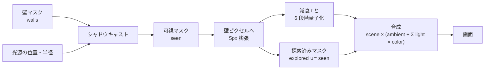

# 2D Shadowcasting — 松明とフォグ・オブ・ウォー

SpriteCook の記事 [2D Shadowcasting for Torchlight and Fog of War](https://www.spritecook.ai/blog/2d-shadowcasting-torchlight-fog-of-war) の手法を、ブラウザ上で**素の JavaScript（依存なし）**で実装したデモです。

**▶ デモ: https://kumi0708.github.io/shadowcasting/**

グリッド上で「光源から見えるセル」を求める**再帰的シャドウキャスティング**を使い、その結果ひとつから次の 3 つを作ります。

- 壁で遮られる**松明の光**
- 一度見た場所を覚えておく**フォグ・オブ・ウォー**
- 敵がプレイヤーを見つけたかどうかの**視線判定**

---

## 目次

1. [操作方法](#操作方法)
2. [全体の処理の流れ](#全体の処理の流れ)
3. [シャドウキャスティングの考え方](#シャドウキャスティングの考え方)
4. [アルゴリズムの詳細](#アルゴリズムの詳細)
5. [ピクセル単位とタイル単位](#ピクセル単位とタイル単位)
6. [壁の上面を照らす（膨張処理）](#壁の上面を照らす膨張処理)
7. [光の減衰と量子化](#光の減衰と量子化)
8. [ライティングの合成](#ライティングの合成)
9. [フォグ・オブ・ウォー](#フォグオブウォー)
10. [敵の視線判定と非対称性](#敵の視線判定と非対称性)
11. [再計算のタイミングと性能](#再計算のタイミングと性能)
12. [記事にない追加要素](#記事にない追加要素)
13. [ハマりどころ](#ハマりどころ)
14. [テスト](#テスト)
15. [ファイル構成と実行方法](#ファイル構成と実行方法)
16. [参考文献](#参考文献)

---

## 操作方法

| 操作 | 内容 |
| --- | --- |
| `WASD` / 矢印キー | プレイヤー（松明を持っている）を移動 |
| クリック | 青い灯火を設置。置いた灯火をもう一度クリックすると撤去（最大 8 個） |
| 光の半径 | 松明の届く距離（24〜160 px） |
| 6段階に量子化 | 減衰をなめらかにするか、6 段階の帯にするか |
| 壁の上面を照らす | 5px の膨張処理のオン／オフ |
| フォグ・オブ・ウォー | オフにすると探索済みの場所も記憶されず、視界の外は真っ黒になる |
| 松明の揺らぎ | 明るさのゆらぎのオン／オフ |
| タイル単位でキャスト | 比較用。タイル単位で判定した結果をピクセルに拡大する |
| 敵の視界を表示 | 敵 3 体の視界を赤くハイライト |

敵はプレイヤーが視界に入ると赤くなり、右下の表示が「発見された」に変わります。

---

## 全体の処理の流れ



ポイントは、**可視判定の結果を「データ」として持つ**ことです。シェーダーで影を描くだけの方式と違い、同じ `seen` 配列を光・フォグ・ゲームロジック（敵の視線）のすべてに使い回せます。

---

## シャドウキャスティングの考え方

光源から周囲を 1 行ずつ外側へ走査していき、**壁にぶつかったら、その壁の後ろにできる「影の扇形」を以降の行では調べない**、というアルゴリズムです。

```
. . ░ ░ ░ ░ ░ . .      @ = 光源
. . . ░ ░ ░ . . .      # = 壁
. . . . ░ . . . .      ░ = 壁の影になり見えない
. . . . # . . . .      影は外側ほど広がる
. . . . @ . . . .
```

- 走査範囲を「傾き（slope）の区間」で表し、壁にぶつかると区間を分割します。
- 各セルを 1 回ずつしか見ないので、計算量はおおむね **半径の 2 乗（光が届く面積）に比例**します。
- 光線を 1 本ずつ飛ばすレイキャストと違って、隙間ができたり同じセルを何度も調べたりしません。

もとは Björn Bergström が RogueBasin で紹介した**再帰的シャドウキャスティング**です。この実装では再帰をやめて、明示的なスタックを使った反復処理にしています（深い再帰によるスタックオーバーフローを避けるため）。

---

## アルゴリズムの詳細

実装: [src/shadowcast.js](src/shadowcast.js) の `shadowcast()`

### 1. 8 つのオクタント（八分円）

周囲 360° を 45° ずつ 8 つに分け、**1 つのオクタント用の走査ロジックを座標変換で 8 回使い回します**。

```
       \  0 | 3  /
     1  \   |   /  2
  -------- @ --------        （画面座標: y は下向き）
     6  /   |   \  5
       /  7 | 4  \
```

オクタント内のローカル座標 `(dx, dy)` は次のように盤面座標へ変換します。

```
x = cx + dx * xx + dy * xy
y = cy + dx * yx + dy * yy
```

| # | (xx, xy, yx, yy) | 向き |
| --- | --- | --- |
| 0 | ( 1,  0,  0,  1) | 北北西 |
| 1 | ( 0,  1,  1,  0) | 西北西 |
| 2 | ( 0, -1,  1,  0) | 東北東 |
| 3 | (-1,  0,  0,  1) | 北北東 |
| 4 | (-1,  0,  0, -1) | 南南東 |
| 5 | ( 0, -1, -1,  0) | 東南東 |
| 6 | ( 0,  1, -1,  0) | 西南西 |
| 7 | ( 1,  0,  0, -1) | 南南西 |

ローカル座標では、`j` 行目を `dy = -j` とし、`dx` を `-j`（斜め 45° 側）から `0`（軸側）へ走査します。

### 2. 傾き（slope）

セル `(dx, dy)` が光源から見てどの角度の範囲を占めるかを、セルの 2 つの角を通る傾きで表します。

```
left  = (dx - 0.5) / (dy + 0.5)   … セルの斜め側の端（大きい値）
right = (dx + 0.5) / (dy - 0.5)   … セルの軸側の端（小さい値）
```

走査中の「まだ見えている範囲」は `start`（斜め側、初期値 1.0）から `end`（軸側、初期値 0.0）までの区間です。

- `start < right` → セル全体が範囲より斜め側にあるので、**スキップ**
- `end > left` → セルが範囲より軸側にはみ出したので、**この行は終了**

### 3. 1 行の走査と壁の処理

```js
for (let dx = -j; dx <= 0; dx++) {
  // ...傾きの判定...
  if (inBounds && dx*dx + dy*dy < r*r) seen[y*w + x] = 1;   // 見えたセルを記録
  const wall = !inBounds || walls[y*w + x];

  if (blocked) {                       // 壁が連続している途中
    if (wall) { newStart = right; continue; }
    blocked = false;                   // 壁が途切れて、また見えるようになった
    start = newStart;                  // 区間の斜め側の端を壁の影の端まで狭める
  } else if (wall && j < radius) {     // 壁の連続が始まった
    blocked = true;
    stack.push([j + 1, start, left]);  // 壁より斜め側の区間は、次の行から別に走査
    newStart = right;
  }
}
if (blocked) break;                    // 行の終わりまで壁が続いた → 残りはすべて影
```

壁に入るたびに「壁の手前（斜め側）」の区間をスタックに積み、壁を抜けたら区間の端を影の境界まで狭めて走査を続けます。これが本来は再帰呼び出しで書かれる部分です。

### 4. 細かいルール

- **壁自体は見える**（光が当たる）。見えなくなるのは壁の後ろだけです。
- **盤面の外は壁として扱う**ので、端で範囲外アクセスが起きません。
- **半径の判定は `<`（未満）**。半径 10 なら、真正面の距離 10 のセルは含まれず、届くのは 9 セル先までです。
- 光源のセルは常に見えます。

---

## ピクセル単位とタイル単位

キャストする格子の細かさは自由です。このデモでは **512×288 px のマップ全体を 1 ピクセル = 1 セル**として扱っています。

| | タイル単位（32×18） | ピクセル単位（512×288） |
| --- | --- | --- |
| 計算量 | とても小さい | 半径 92 でも 0.1 ms 程度 |
| 見た目 | 光が四角くなり、描かれた壁の上に光がはみ出す | 壁の輪郭に沿ったなめらかな影 |
| 向いている用途 | 敵 AI の判定、ローグライクのマス目表示 | 見た目のライティング |

パネルの「タイル単位でキャスト」をオンにすると、タイル単位の結果をピクセルに拡大した状態を比較できます。記事でも、見た目の光は**ピクセル単位で壁レイヤーに対してキャストする**ことが勧められています。タイルの見た目が格子と半タイルずれる dual-grid タイルセットでは、特にこの差が大きくなります。

---

## 壁の上面を照らす（膨張処理）

実装: `lightWallDepth()`

シャドウキャスティングでは、壁は「最初にぶつかったセル」しか見えません。ピクセル単位だと、**壁の上面が縁の 1 ピクセルだけ光り、奥は真っ暗**になってしまいます。

そこで、見えている領域を**マンハッタン距離 5 まで膨張**し、そのうち**壁のピクセルだけ**を見えている扱いにします。

```
seen |= walls & dilate(seen, 5)
```

`dilate` は十字形（上下左右）の構造要素で 5 回膨張させる処理で、scipy の `binary_dilation(seen, iterations=5)` と同じ結果になります。床には足さないので、影の中の床が見えてしまうことはありません。深さ 5px は 16px タイルに合わせた値なので、タイルサイズに応じて調整します。

---

## 光の減衰と量子化

光源からの距離 `d`、半径 `R` に対して次のように計算します。

```
t     = clamp(1 - d / R, 0, 1) ^ 0.8
light = ceil(t * 6) / 6        （見えているピクセルだけ。それ以外は 0）
```

- 指数 `0.8` で、線形よりも少し遠くまで明るさを保ちます。
- `ceil(t × 6) / 6` で **6 段階のフラットな帯**にし、ピクセルアートに合うドット絵風の光にします。`ceil` なので、光が届いていれば最低でも 1/6 の明るさになります。

| t の範囲 | light |
| --- | --- |
| 0 | 0（届かない） |
| 0 < t ≤ 1/6 | 1/6 |
| 1/6 < t ≤ 2/6 | 2/6 |
| … | … |
| 5/6 < t ≤ 1 | 1 |

---

## ライティングの合成

見えているピクセルの最終色は次の式で求めます。

```
lit = scene × (ambient + Σ light_k × color_k × flicker_k)
```

| 定数 | 値 | 意味 |
| --- | --- | --- |
| `ambient` | (0.045, 0.05, 0.09) | 環境光。影の中もごくわずかに青く見える |
| 松明の色 | (1.0, 0.80, 0.55) × 1.15 | 暖かいオレンジ |
| 灯火の色 | (0.45, 0.75, 1.1) | このデモで追加した青い光 |

記事で紹介されている Python/numpy 版ではこれを配列演算で、Godot や Unity ではテクスチャに書き出して乗算シェーダーで合成します。このデモでは Canvas の `ImageData` を 1 ピクセルずつ計算し、CSS の `image-rendering: pixelated` で拡大表示しています。

---

## フォグ・オブ・ウォー

各ピクセルは 3 つの状態のどれかになります。

| 状態 | 条件 | 表示 |
| --- | --- | --- |
| 視界内 | `seen` | 上の式でライティング |
| 探索済み | `explored && !seen` | 背景の明るさ `(R+G+B)/3` × (0.30, 0.32, 0.40) の**灰青のモノクロ** |
| 未探索 | どちらでもない | 黒 |

- `explored` はキャストのたびに `explored |= seen` で更新し、リセットしない限り消えません。ゲームではレベルのセーブデータに含めます。
- 探索済みの部分は、スプライトを描く前の**背景だけ**から作っています。こうしないと、視界の外にいる敵がフォグの中に見えてしまいます。

---

## 敵の視線判定と非対称性

同じ関数を、敵の位置から敵の視界の半径（72 px）でキャストするだけで視線判定になります。

```js
shadowcast(walls, W, H, enemyX, enemyY, 72, sight);
const spotted = sight[playerY * W + playerX] === 1;
```

注意点として、このアルゴリズムは**対称ではありません**。「A から B が見える」でも「B から A が見える」とは限りません。記事の検証では、記事のマップのタイルの組のうち約 16% が片方向でした。ゲームで公平さが重要なら、**Albert Ford の Symmetric Shadowcasting** のような対称版を使います。

---

## 再計算のタイミングと性能

### 再計算は光源が別のセルに移ったときだけ

`updateLight()` は「位置（整数ピクセル）・半径・各種オプション」をキーにしてキャッシュし、キーが変わったときだけキャストし直します。毎フレーム行うのは、合成と揺らぎの計算だけです。

### 実測値

512×288 の盤面、Node.js v24、この開発マシンでの 1 回あたりの平均です（`shadowcast` 単体）。

| 処理 | 時間 |
| --- | --- |
| キャスト 半径 32 | 0.033 ms |
| キャスト 半径 64 | 0.080 ms |
| キャスト 半径 92 | 0.117 ms |
| キャスト 半径 128 | 0.157 ms |
| タイル単位キャスト（32×18、半径 6） | 0.005 ms |
| 半径 92 のキャスト ＋ 5px 膨張 | 2.7 ms |

キャスト自体はとても速く、毎フレーム敵 3 体分を計算しても問題ありません。今のボトルネックは**膨張処理**で、盤面全体を 5 回なめているためです。光の届く範囲（半径＋5 の矩形）に限定すれば、大きく短縮できます。

---

## 記事にない追加要素

記事では扱っていない部分を、このデモでは次のように実装しています。

- **松明の揺らぎ**: 周期の違う sin 波を 3 つ足して、明るさの係数にします。半径は変えないので、帯の形はちらつきません。
  ```
  f = 1 + 0.06·sin(11t + φ) + 0.04·sin(23.3t + 2φ) + 0.03·sin(37.1t)
  ```
- **複数の光源**: 光源ごとに個別にキャストし、`light × color` を**加算**します。ただし表示するのはプレイヤーの視界内だけです（見えていない場所の灯火の光は見えない）。
- **敵の視界の可視化**: 3 体の視界の和集合を赤く重ねます。

---

## ハマりどころ

- **光源が壁の中にある**と、周囲 8 セルしか見えません。光源は最寄りの床セルに移してからキャストします。
- **ドア**を開け閉めしたら、`walls` を書き換えて再キャストします。
- **キャストする格子とテクスチャの対応**: 見た目の壁（タイル画像）と遮蔽データの格子がずれていると、光が壁を貫通して見えます。

---

## テスト

記事に載っている期待値で、アルゴリズムが正しく動くことを確認しています。

```bash
npm test
```

| ケース | 期待値 |
| --- | --- |
| 空の 11×11、中心 (5,5)、半径 3 / 4 / 5 | 25 / 45 / 69 セル |
| 同上、半径 4 | (8,5) は見える、(9,5) は見えない |
| (7,5) に壁、半径 6 | 106 セル。壁 (7,5) は見えるが、(8,5)〜(10,5) は見えない |
| 全部壁の 7×7、中心 (3,3)、半径 3 | 9 セル |
| 空の 6×6、角 (0,0)、半径 4 | 15 セル（範囲外エラーなし） |
| 閉じた部屋の外から | 部屋の中の床はどの半径でも見えない |
| 列 5 が壁、敵 (2,5)、プレイヤー (8,5)、視界 10 | 見えない。(5,5) の壁を外すと見える |

---

## ファイル構成と実行方法

```
.
├── index.html               ページと操作パネル
├── src/
│   ├── shadowcast.js        シャドウキャスト本体と膨張処理（DOM 非依存）
│   └── main.js              マップ生成・光・フォグ・敵・描画ループ
├── test/
│   └── shadowcast.test.mjs  記事の期待値によるテスト
└── serve.mjs                依存なしの静的ファイルサーバー
```

ES Modules を使っているので、`file://` ではなく HTTP サーバー経由で開きます。

```bash
npm start
```

http://localhost:8173 を開きます。`src/shadowcast.js` は DOM に依存しないので、そのまま Node.js やほかのプロジェクトでも使えます。

---

## 参考文献

- [2D Shadowcasting for Torchlight and Fog of War](https://www.spritecook.ai/blog/2d-shadowcasting-torchlight-fog-of-war) — SpriteCook（このデモの元記事）
- [FOV using recursive shadowcasting](https://www.roguebasin.com/index.php/FOV_using_recursive_shadowcasting) — Björn Bergström, RogueBasin
- [Symmetric Shadowcasting](https://www.albertford.com/shadowcasting/) — Albert Ford
